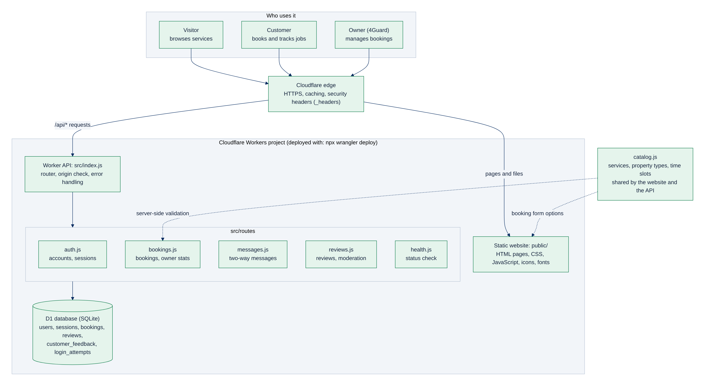
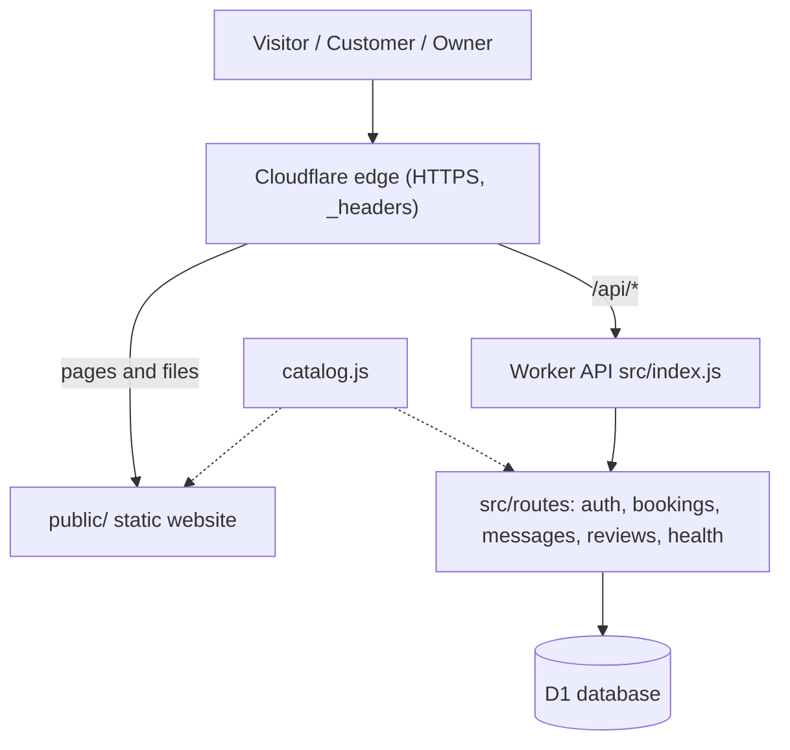
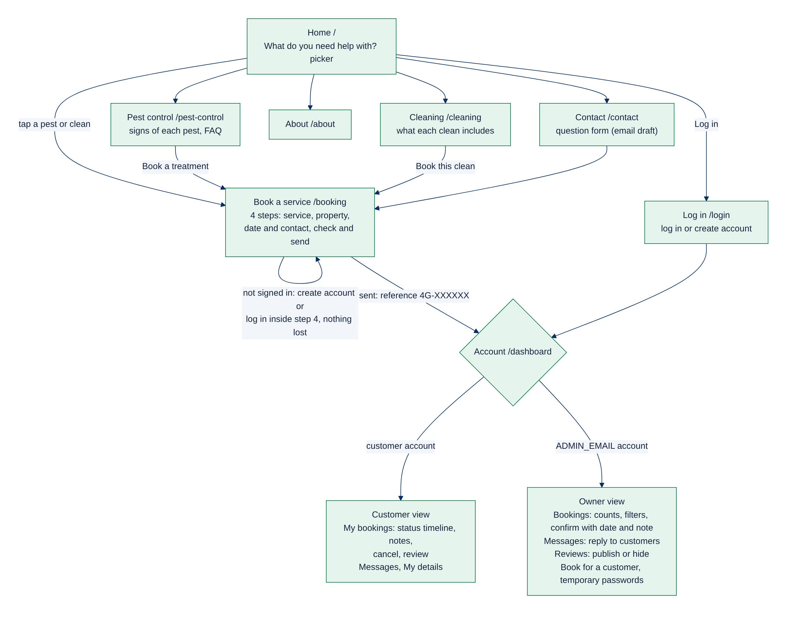
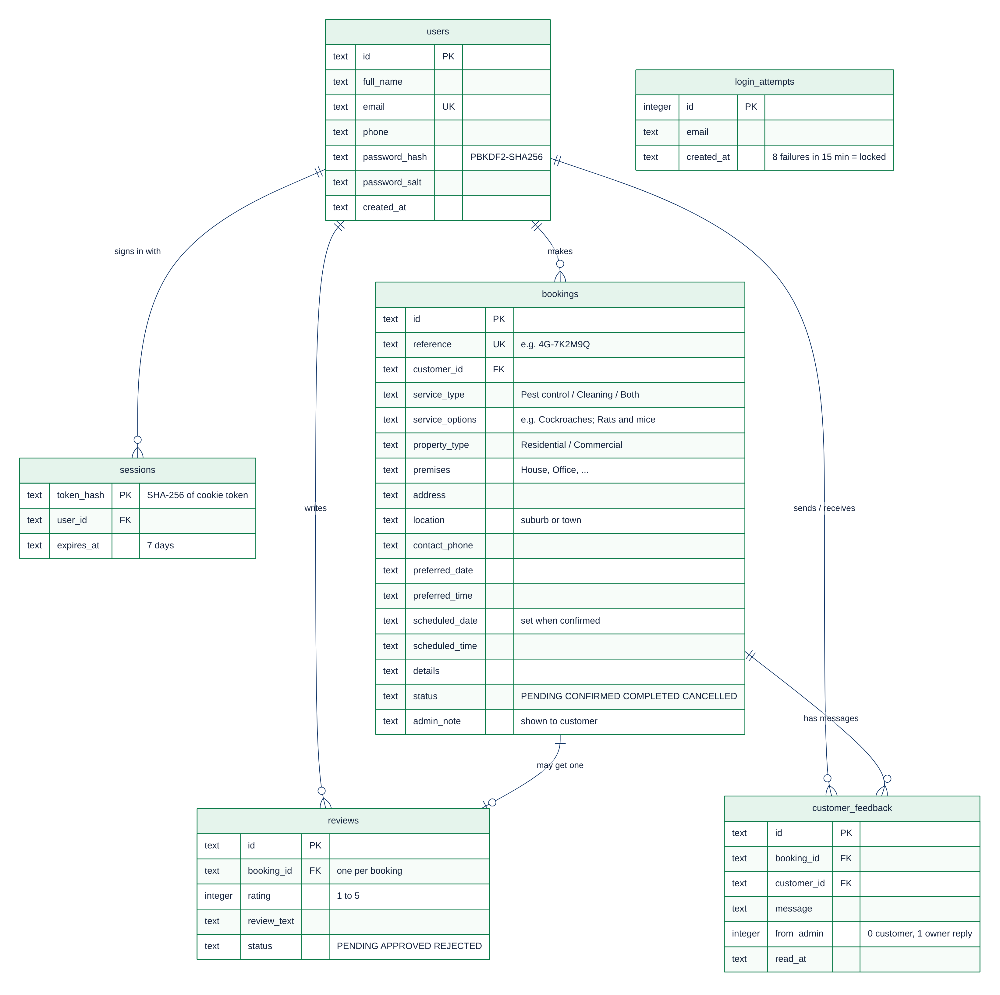
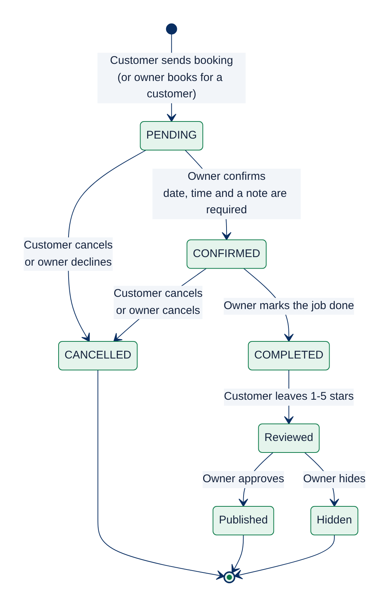
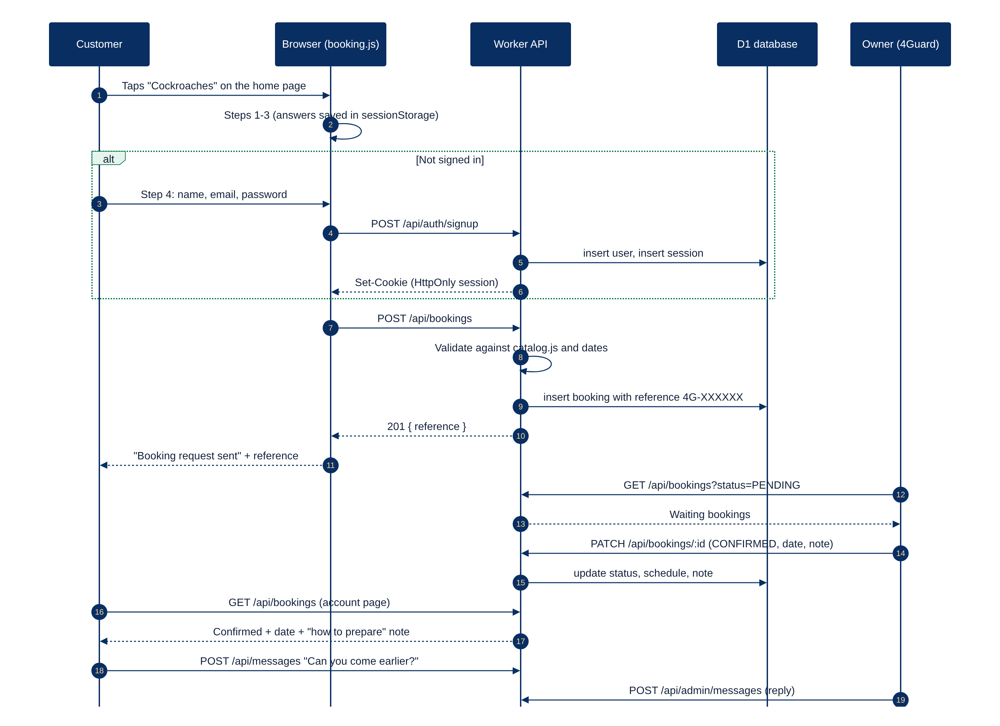
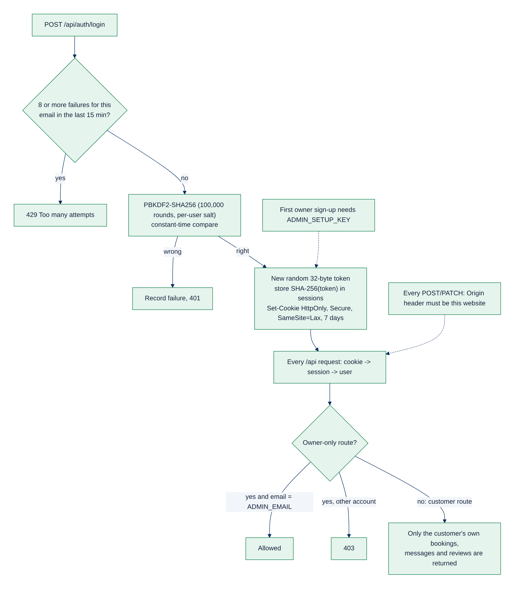

# 4Guard Cleaning & Pest Solutions — system design

Website and booking portal for 4Guard, a pest control, fumigation and cleaning business.
Designed and developed by **Neuropulse Inc.**

> Open `docs/index.html` in a browser for the illustrated version of this document.
> Each diagram below has an editable source in `docs/diagrams/*.mmd` (Mermaid). GitHub draws them automatically.

---

## 1. Goals

| Goal | How the system meets it |
|---|---|
| It is obvious within seconds that 4Guard does pest control and cleaning | Home page headline, a **"What do you need help with?"** picker with pest and cleaning icons, and separate *Pest control* and *Cleaning* pages in the main menu |
| Booking is quick and hard to get wrong | A 4-step booking form (service → property → date and contact → check and send), with options taken from one shared service catalogue |
| Logging in never gets in the way | Visitors can browse everything. In the last booking step they create an account or log in **inside the form**; their answers are kept, and one button signs in and sends |
| Customers always know where their job stands | Each booking has a reference (e.g. `4G-7K2M9Q`), a status timeline, the confirmed date and a note from 4Guard on how to prepare, plus two-way messages |
| The owner can run the day from one screen | Counts of waiting, today's, confirmed, completed and cancelled jobs; search; confirm with date, time and note; reply to messages; publish reviews; book for phone customers |
| Secure by default | Hashed passwords, HttpOnly session cookies, server-side role checks, login throttling, origin checks, strict security headers |
| Cheap to run and simple to deploy | Everything runs on Cloudflare's free tier: one `npx wrangler deploy` |

## 2. Architecture





* **Cloudflare Workers + Static Assets** serve the website from `public/`. Only `/api/*` requests run code (`run_worker_first`).
* **Worker API** (`src/`) is plain JavaScript with no framework: a small route table, shared helpers and one file per area.
* **D1** is Cloudflare's SQLite database. The schema is managed with numbered migrations in `migrations/`.
* **`public/assets/js/catalog.js`** lists every service, property type and time slot. The booking form shows these options and the API validates against the same file, so they can never drift apart.

## 3. Pages and user journeys



| Page | Address | Purpose |
|---|---|---|
| Home | `/` | Headline, service picker, pests and cleaning overview, how booking works, reviews |
| Pest control | `/pest-control` | Every pest with signs to look for, booking buttons, preparation FAQ |
| Cleaning | `/cleaning` | Every type of clean with what it usually includes, FAQ |
| About | `/about` | Company story, logo, how 4Guard works |
| Contact | `/contact` | Contact details from `config.js`, question form (opens an email draft) |
| Book a service | `/booking` | 4-step booking with in-form sign-in |
| Log in | `/login` | Log in or create an account; returns you to where you came from |
| Account | `/dashboard` | Customer view or owner view, depending on who is signed in |
| Not found | `404.html` | Friendly page for broken links |

Deep links pre-fill the booking form: `/booking?service=termites`, `/booking?category=cleaning`, `/booking?category=both`.

## 4. Data model



| Table | Holds |
|---|---|
| `users` | Accounts: name, email, phone, salted password hash |
| `sessions` | SHA-256 hashes of session tokens (the token itself only lives in the customer's cookie) |
| `bookings` | Each job: reference, services, property, address, preferred and scheduled date/time, status, note to customer |
| `reviews` | One rating per completed booking; published only after the owner approves |
| `customer_feedback` | Messages about a booking, both directions (`from_admin` = 1 for 4Guard replies) |
| `login_attempts` | Recent failed logins, used to lock an email for 15 minutes after 8 failures |

## 5. Booking lifecycle



* **Waiting for confirmation (`PENDING`)** — the customer sent a request.
* **Confirmed** — the owner chose the date and time of day and wrote a note (required) such as how to prepare.
* **Completed** — job done; the customer can now leave a 1–5 star review.
* **Cancelled** — by the customer (from their account, with an optional reason that is sent to 4Guard as a message) or by the owner.

## 6. How a booking flows through the system



## 7. Security



| Risk | Protection |
|---|---|
| Stolen password database | PBKDF2-SHA256 with 100,000 rounds and a unique salt per user |
| Session theft through scripts | Session token in an `HttpOnly`, `Secure`, `SameSite=Lax` cookie; only its hash is stored |
| Password guessing | 8 failed attempts for an email locks it for 15 minutes |
| Someone claiming the owner account | The owner email can only be registered with the private `ADMIN_SETUP_KEY` |
| Customers seeing other people's data | Every query is filtered by the signed-in customer on the server; owner routes check `ADMIN_EMAIL` |
| Cross-site request forgery | `SameSite=Lax` cookie plus an `Origin` check on every change |
| Bad or malicious input | Every field validated on the server against the catalogue, with length limits; all output escaped in the browser |
| Clickjacking, script injection | `public/_headers`: Content-Security-Policy (`script-src 'self'`), `X-Frame-Options: DENY`, `nosniff`, strict referrer |
| Forgotten passwords | No email service is connected, so the owner can issue a temporary password from *My details*; the customer then changes it |

## 8. API reference

All endpoints are under `/api`, return JSON and use the session cookie.

| Method | Path | Who | What |
|---|---|---|---|
| GET | `/health` | anyone | Database connected and migrated? |
| POST | `/auth/signup` | anyone | Create account (and sign in) |
| POST | `/auth/login` | anyone | Sign in |
| POST | `/auth/logout` | signed in | Sign out |
| GET | `/me` | anyone | Current user, or `null` for visitors |
| PATCH | `/me` | signed in | Update name and phone |
| POST | `/me/password` | signed in | Change password (signs out other devices) |
| GET | `/bookings` | customer: own; owner: all (`?status=`, `?q=`) | List bookings |
| POST | `/bookings` | signed in | Create a booking |
| POST | `/bookings/:id/cancel` | customer (own) | Cancel an upcoming booking |
| PATCH | `/bookings/:id` | owner | Status, scheduled date/time, note |
| GET / POST | `/messages` | customer | Own messages / send a message about a booking |
| GET | `/reviews` | anyone | Published reviews and average rating |
| POST | `/reviews` | customer | Review a completed booking |
| PATCH | `/reviews/:id` | owner | Publish (`APPROVED`) or hide (`REJECTED`) |
| GET | `/admin/stats` | owner | Counts for the owner dashboard |
| POST | `/admin/bookings` | owner | Book for an existing customer |
| GET / POST | `/admin/messages` | owner | All conversations / reply |
| POST | `/admin/messages/read` | owner | Mark as read |
| GET | `/admin/reviews` | owner | All reviews |
| POST | `/admin/users/reset-password` | owner | Temporary password for a customer |

## 9. Project structure

```text
4GUARD/
├── README.md                 Setup, deployment and owner guide
├── wrangler.toml             Cloudflare config: Worker, static assets, D1 binding, migrations
├── package.json              npm scripts: dev, db:migrate:local, db:migrate:remote, deploy
├── .dev.vars.example         Template for local secrets (ADMIN_EMAIL, ADMIN_SETUP_KEY)
├── migrations/
│   ├── 0001_initial.sql      Original schema (safe to re-run)
│   └── 0002_bookings_v2.sql  References, detailed bookings, messages, login throttling
├── src/                      Worker API (server side)
│   ├── index.js              Route table, origin check, error handling
│   ├── lib/
│   │   ├── http.js           JSON responses, body parsing, validation helpers
│   │   └── auth.js           Password hashing, sessions, roles, login throttling
│   └── routes/
│       ├── auth.js           Sign up, log in, log out, my details, passwords
│       ├── bookings.js       Create, list, update, cancel, owner stats
│       ├── messages.js       Customer ↔ 4Guard messages
│       ├── reviews.js        Reviews and moderation
│       └── health.js         Health check
├── public/                   Website (served as static files)
│   ├── index.html            Home
│   ├── pest-control.html     Pest control and fumigation
│   ├── cleaning.html         Cleaning services
│   ├── about.html  contact.html  booking.html  login.html  dashboard.html  404.html
│   ├── _headers              Security headers
│   ├── _redirects            Old links (services.html → /pest-control)
│   └── assets/
│       ├── css/styles.css    Design system
│       ├── fonts/            Archivo variable font (self-hosted, SIL OFL)
│       ├── img/              4Guard logo and marks, icons.svg sprite, Neuropulse logo
│       └── js/
│           ├── config.js     Business contact details (edit before launch)
│           ├── catalog.js    Services, property types, time slots (shared with API)
│           ├── api.js        API client and display helpers
│           ├── site.js       Menu, account link, contact details (every page)
│           ├── home.js  booking.js  login.js  dashboard.js  contact.js
└── docs/
    ├── index.html            Illustrated system design (open in a browser)
    ├── SYSTEM_DESIGN.md      This document
    └── diagrams/             Mermaid sources (.mmd) and rendered .svg / .png
```

## 10. Design system

| Token | Value | Use |
|---|---|---|
| Navy | `#092E62` | Headings, header text, hero background (from the logo) |
| Green | `#10965A` / `#0B7A48` | Brand accent / buttons with white text (meets WCAG AA contrast) |
| Mint | `#E5F4EC` | Selected options, notes from 4Guard, cleaning section |
| Surface | `#F2F5F9` | Cool, clinical light grey for app screens |
| Typeface | Archivo (variable) | Wide and heavy for headings, like lettering on a service vehicle; normal width for reading |

Icons are a custom set drawn for this project (`public/assets/img/icons.svg`): cockroach, rodent, termite, bed bug, ant, flea, fly, fumigation, plus cleaning and interface icons. They inherit colour from CSS.

Accessibility: keyboard focus is always visible, the booking steps announce themselves to screen readers, form errors are linked to their fields, colours meet contrast guidelines, and motion is reduced when the visitor's device asks for it.
